秋芝 claude code 教学

## 一 .Claude Code  是什么？

- 本身就是一个agent程序（为编程而生） 简称CC
-

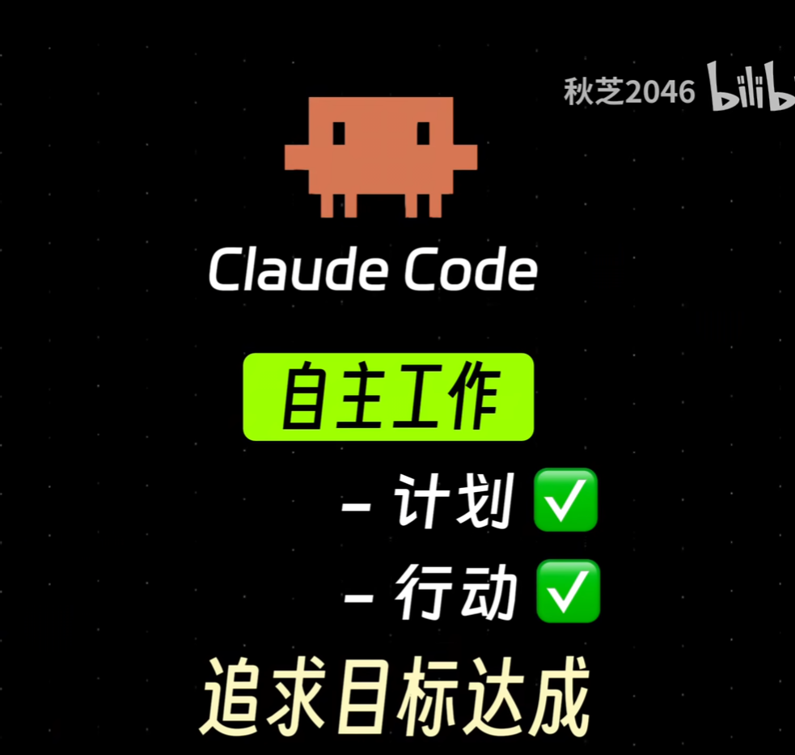

实现以上效果的最基本模式 就是      ：    ==LLM LOOP   大模型循环    ==

==Ctrl +shift +m    变亮==

==ctrl + shift + i     插入图片 ==

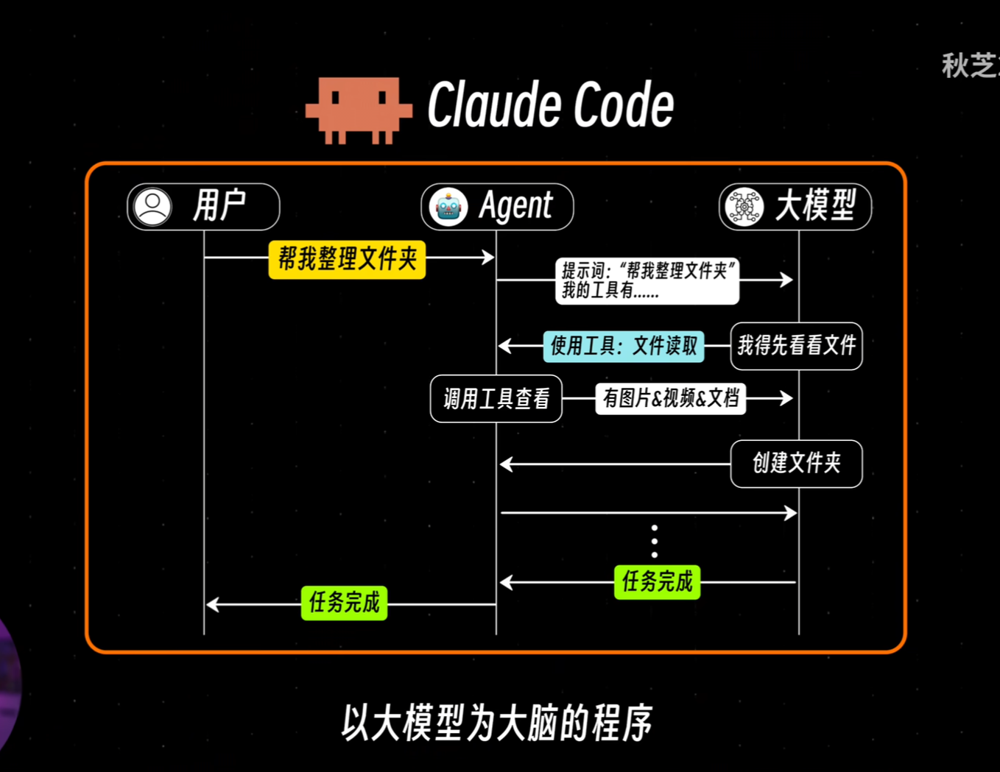

CC 优势：

1. 本地运行 

  CC是运行在本地的     可以访问-->  你的本地文件  +你的终端+ 你的电脑执行命令+下载到你的电脑上。

2 Harness  工程 做得更好

CC 是运行在你本地的，Harness工程优秀的 顶尖Agent

# 二 . CC 有什么用

#### 1.  开发应用做编程   

#### 2. 写文案、查资料、整理资料 、分析数据、做表格、写报告、以及更多你定制的专属任务。 

  秋芝的内容创作中，用的最多的工具也是CC。 甚至我们的运营， 剪辑， 也经常用CC去做文稿的分析，素材匹配。。

claude  订阅会员， 最划算。

CC Switch  -- 多模型切换/管理 

以下是链接：

shift + tap 键  三种模式切换。

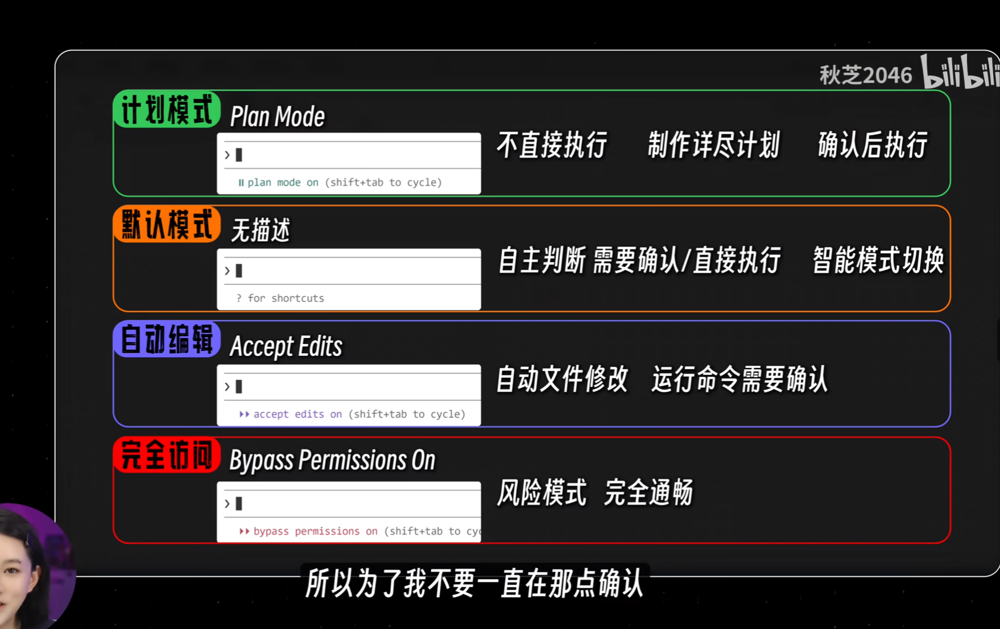

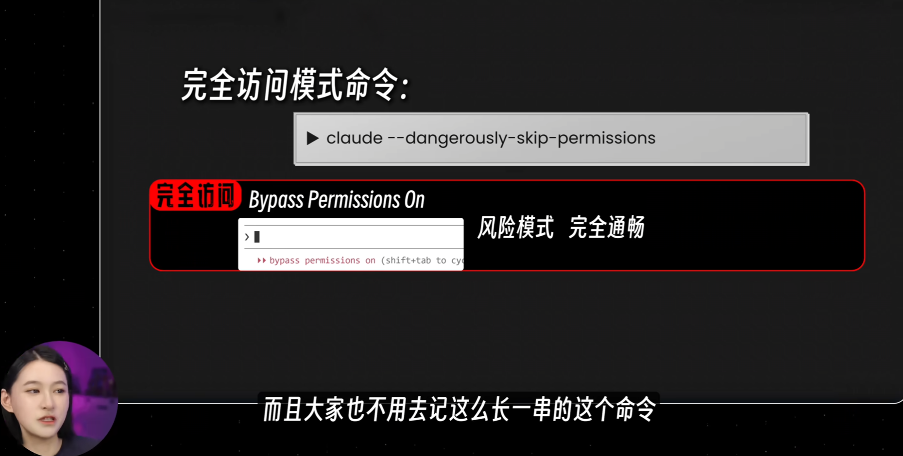

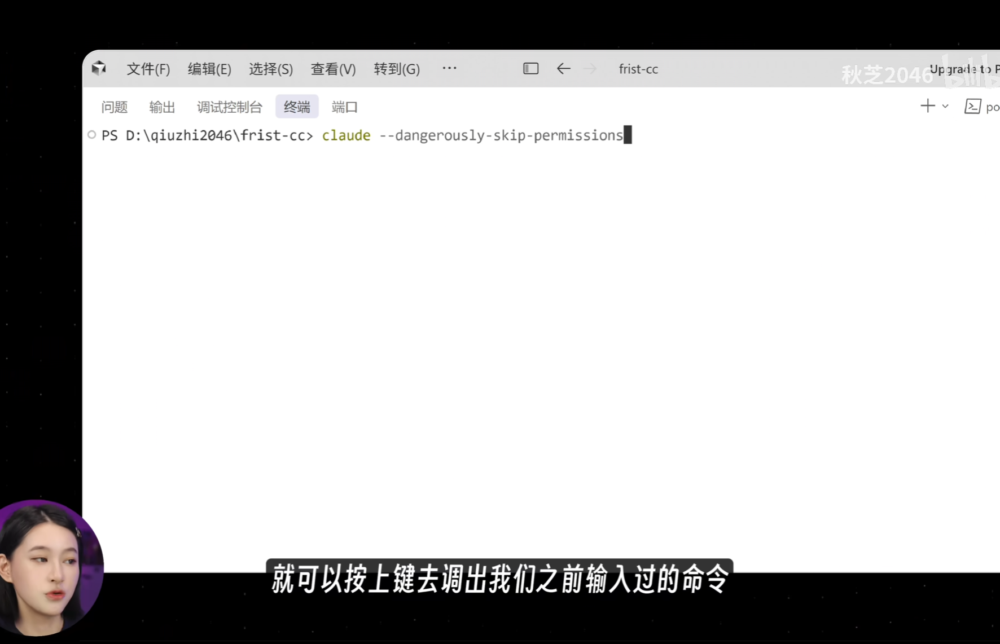

每次进入时， 按照上键 调出 我们之前输入过的命令

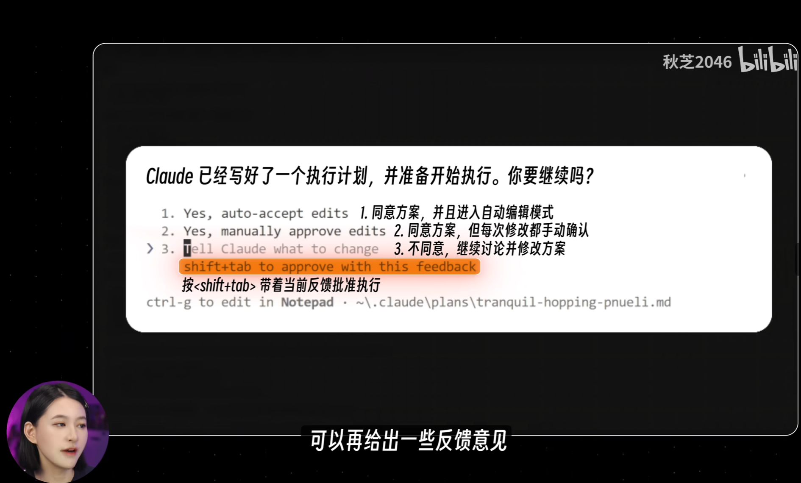

想要运行写好的程序， 两个方式   第一个 新开一个终端 + 号，

第二种  ！（感叹号）  ！for bash mode  就是命令行工具，就不再是和CC对话了。

@ renderer.js  解释一下这个文件的代码逻辑，并且详细的中文注释上，

 更精准的把上下文给到CC。

 因为CC 不会每时每刻把旁边的文件都加载到它的上下文中。 所以， 一个文件夹就是一个文件比较好。

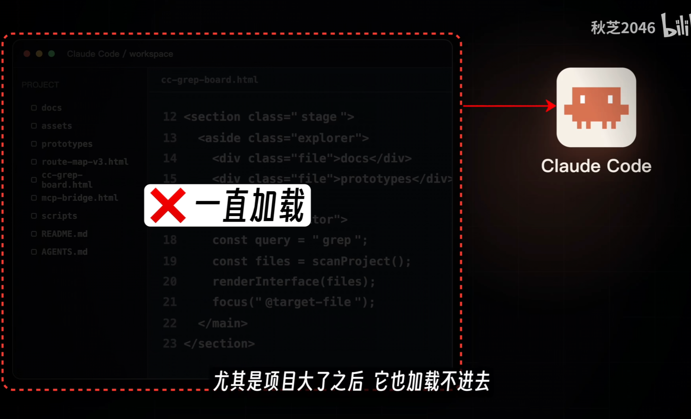

 通过的是grep的方式 本地查找文件。

 Windows上 ctrl+回车   是换行

1. 本地先建一个文件（要求文件）， 然后写上我们更详细的具体的要求。 通过@文件的方式。   避免了对话框中的不便。

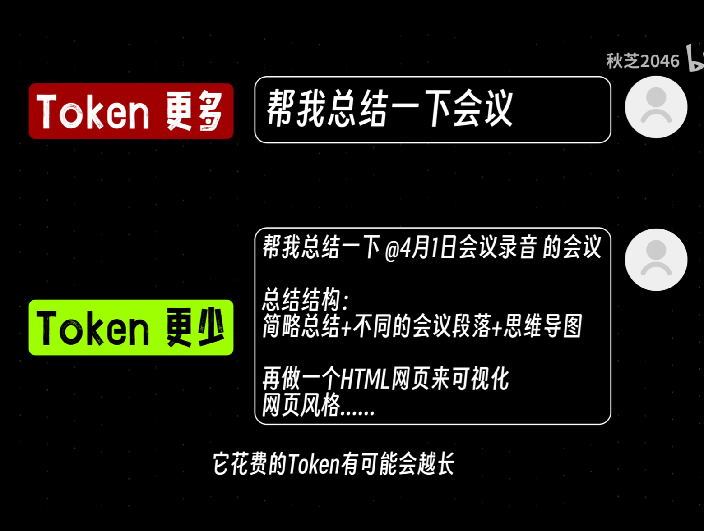

因为当我们给的指令不足，上下文不全的时候， 它就需要花费更多token去探索我们的。从而会烧的token更多。   那同时， 我们给的描述越具体，它执行的结果也会越准确，越靠谱。

2.  图片   拖拽到对话框中或者ctrl+v    毕竟，一图胜千言

3.  / 斜杠     /help  会告诉我们所有命令。

   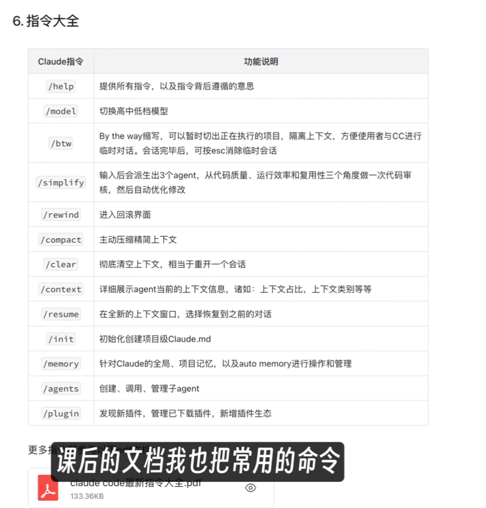

- /model 
- /btw    by the way    坐着坐着什么事，稳点无关的东西，   此时这个回答是和我们原本项目的上下文是隔离开的。 沟通完后 按 ESC键   直接退出   退出后会自动消失在上下文当中了。
- /simplify  本质上是一个内置skill ， 此时会启动3个审查Agent。 从代码质量，运行效率， 可复用性自动做代码审核和优化修改。

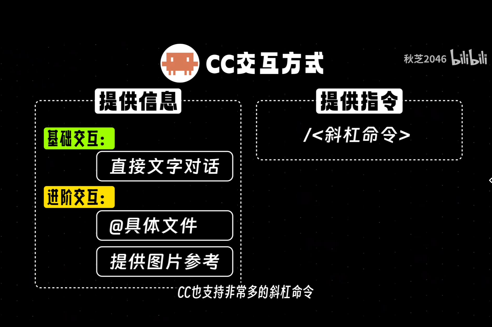

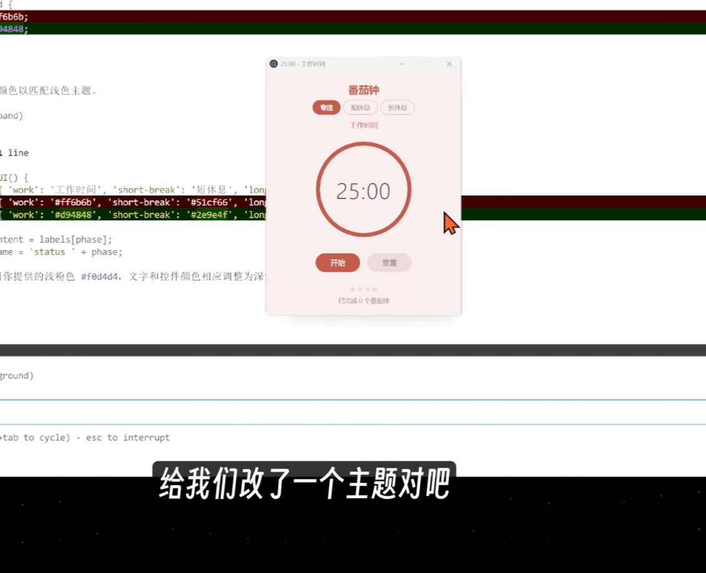

发给CC 一个照片，更该了番茄闹钟的主题。

CC 自带一个== 快捷的回滚功能==。  按两下ESC  或者 /rewind  或者说就撤回界面。

Restore code  and conversation  正常是 回滚对话和刚才编辑过的文件。 （快捷的回滚有个局限， 只能撤销CC 自己编辑过的文件。如果CC 执行了一些终端命令，比如安装了一些包，下载了一些东西在我们这个项目里， 那这些它是撤回不了的。）

#### 真正靠谱的后悔药是git

-  类似于 游戏的 存档系统  

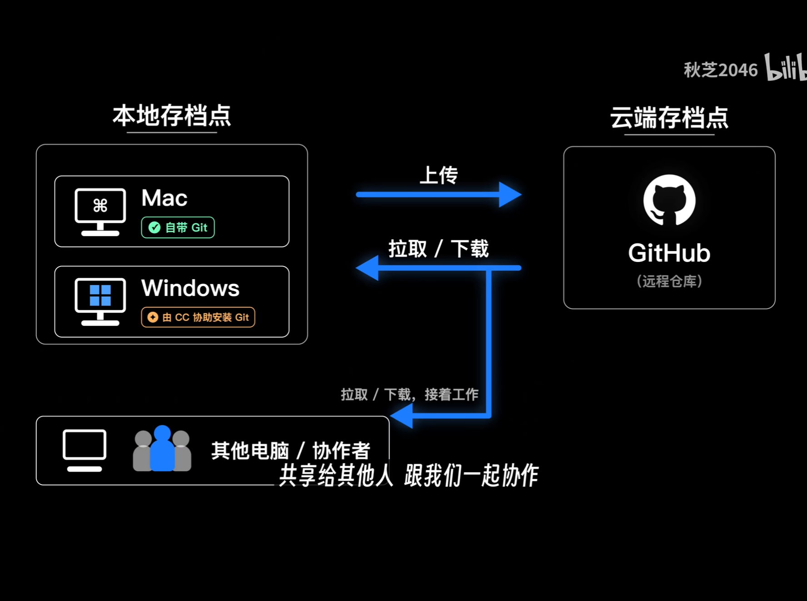

有个github 账号，存在github上。  以后我们再其他电脑上，也能够快捷的拉下那个存档点，再基于它去工作，  而且我们也更方便，共享给其他人， 跟我们一起协作。

有了CC 以后， 都可以通过自然语言，来让CC帮你完成了。

大家都不用害怕不熟悉，反正有了AI ，  我们用着用着就会熟悉的。

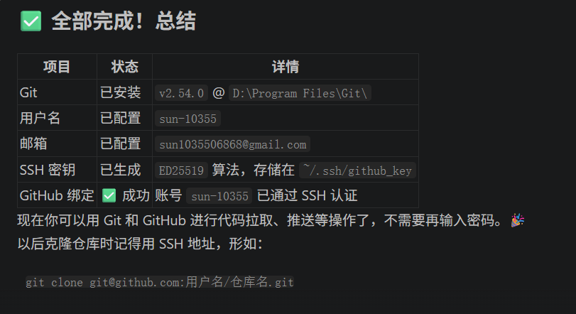

### 在CC中输入的：

- 帮我下载git， 并且跟我的github账号绑定
- 帮我把现在这个分支，提交到远程仓库去。
  -  此时看github仓库， 就会多出来一个番茄钟的项目
- 帮我回滚到上一个版本的存档 

### 养成 版本管理的习惯  --笑来老师说的 git  必备使用 类似于后悔药

 每做一步，保存一步。

## 如果设置好了程序，输入：  ！for bash mode   然后就进入命令提示符，  然后 输入 npm

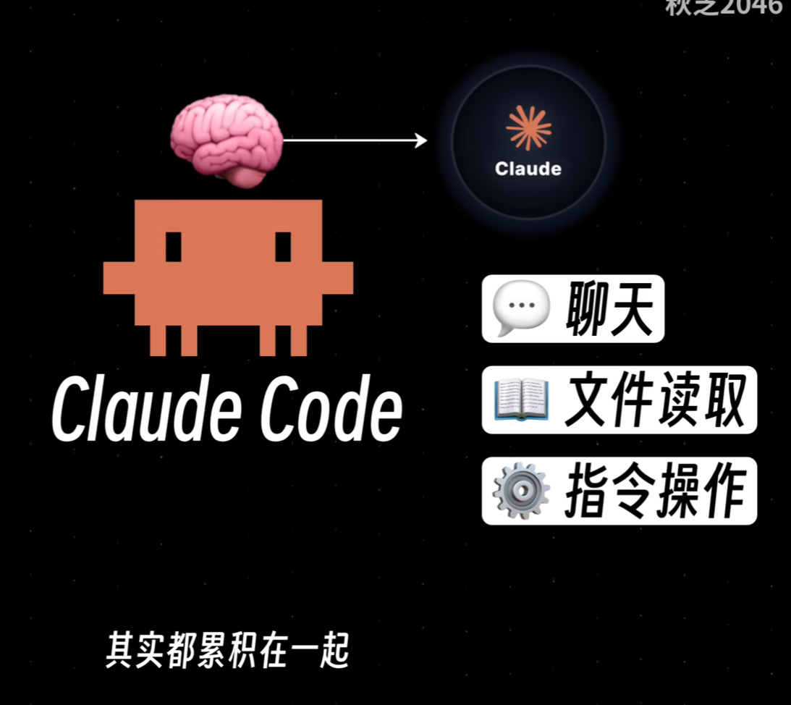

用一段时间，CC的回答变慢，结果质量也下降了，这就是萦绕在现在所有AI头上最困扰的问题。 上下文窗口有限。

因为CC的大脑也是我们熟知的那些大模型，从开始对话， 我们聊的每句话，它读的每一个文件，它执行的每一个操作结果， 其实都累积在一起。占用了这个大模型大脑的上下文空间。而且我们平时看到的那些大模型， 动辄就是100万200万的上下文窗口，但实际上它有效的比例只有60%-80%，而且会随着上下文的增多， 大模型的能力会随之下降。

### vs   应对以上状况  两个方法：

1.      == /compact  主动去压缩上下文==。   精简信息，保留关键信息。

- 在介绍完某些任务， 主动去压缩    对话框输入 /compact  省token 更高效 大模型更专注于 当前任务。

2.   == /clear   彻底清空==。 相当于重开一个对话了。  秋芝用的不多，    重开的话， ==点+号==   更方便。
3. == /context  ==这个命令会详细的给我们展示 上下文的占比，包括cc上下文中 有哪些MCP、 哪些skill

类似于下边。   

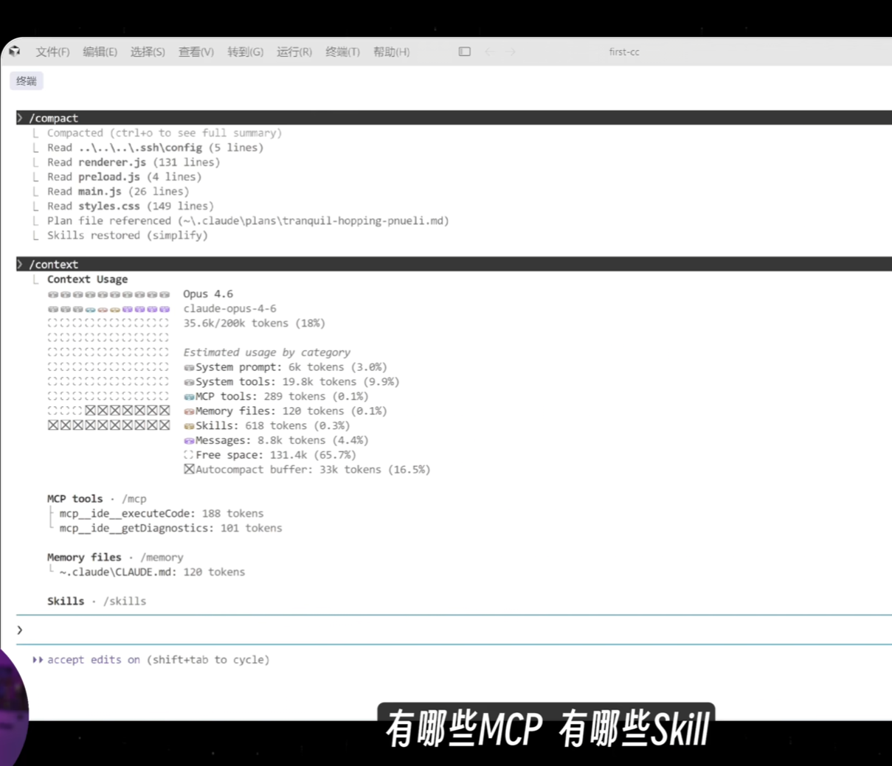

4. 如何 ==随时看到上下文占比==。

- 输入 ： 帮我配一个 statusline， 能显示当前目录+模型+上下文剩余百分比的功能。

打开后， 重启才有效。 连续按两次ctrl+c 就退出了cc的对话。

再重新进入时，会发现进入了一个新的对话。此时是没有任何上下文的。如何回到之前的番茄钟的两个对话呢？ 有两个命令

5. /resume 此时可以选择回复到哪一次对话了。
6. 输入claude的同时 claude -c (全拼就是 continue的意思)

  高于60%以上， 大概率要/compact  压缩一下了。

##  有后悔药， 也知道主动管理上下文， 接下来 我们要让CC个性化的服务于你

### 个性化

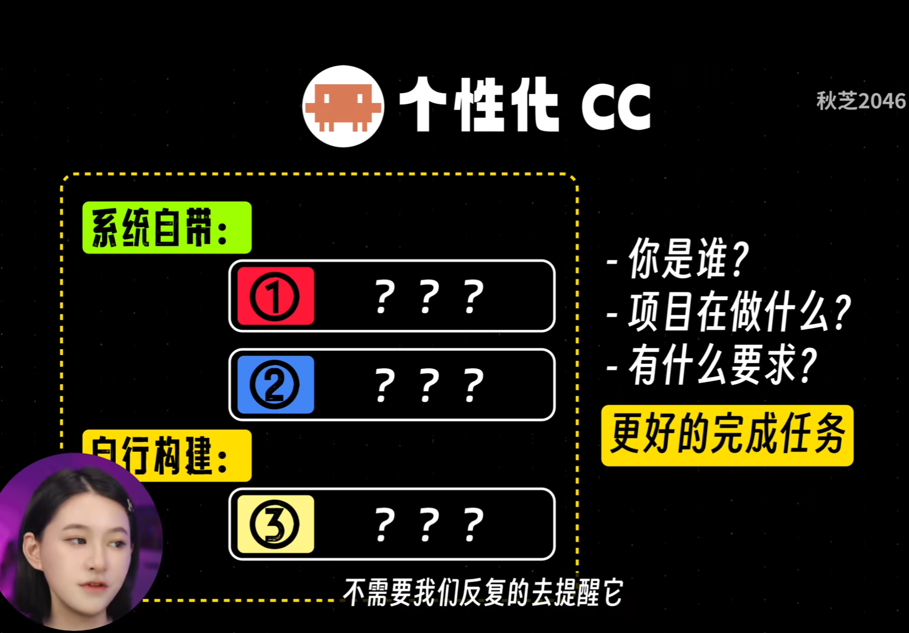

- [CLAUDE.md](http://CLAUDE.md)  :    是一个写着文字的markdown文件。  它会在我们和CC说任何东西之前，第一时间被读入上下文。

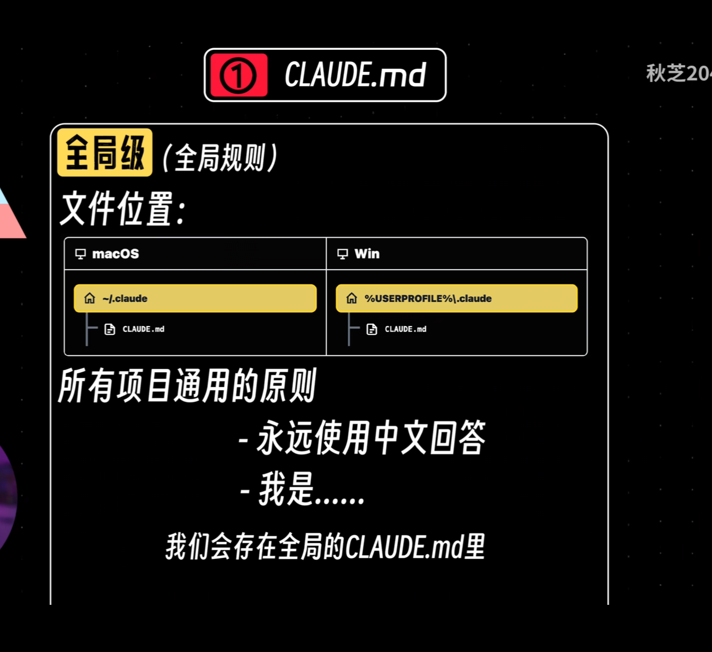

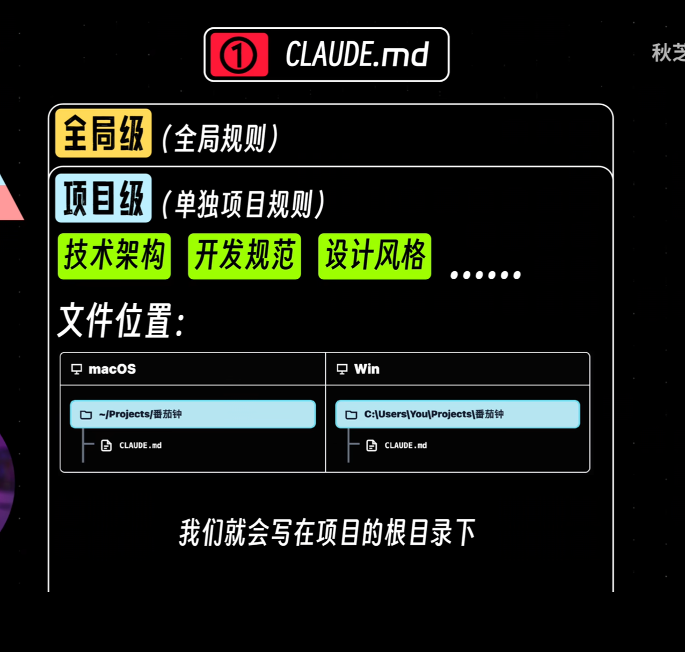

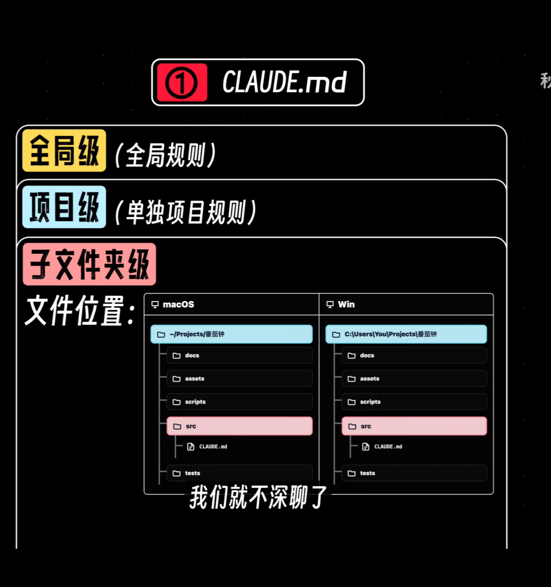

[怎么创建CLAUDE.md](http://怎么创建CLAUDE.md) 文件

这是项目级的：

- [项目级的CLAUDE.md](http://项目级的CLAUDE.md) 
- /init    （输入这个后，CC会帮我们初始化整个的这个项目）

等项目有雏形差不多了，再用/init 来初始化它。 

[全局的CLAUDE.md](http://全局的CLAUDE.md)   两种创建方式：

1.  直接让Claude code  自己写到全局的CLAUDE.md

